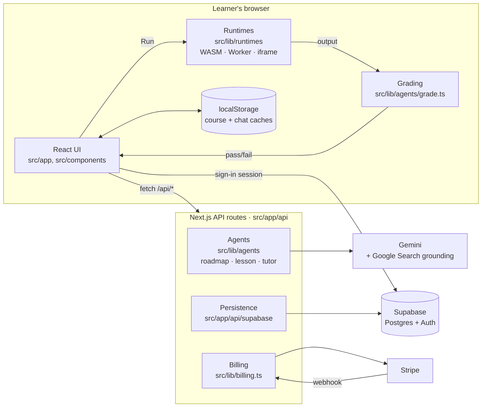

# Architecture

How the pieces of CodeChad fit together. Read this first; the other documents in
[`docs/`](README.md) go deep on one part each.

## The one idea

**Learner code never runs on a server.** Every language and database executes in the
learner's own browser tab, as WebAssembly, a Web Worker or a sandboxed iframe. The server
does three things only: it talks to Gemini, it reads and writes Supabase, and it talks to
Stripe. That is what keeps the app cheap to run, and why there is no execution backend.

The second rule: **the AI teaches, code decides.** Gemini writes roadmaps, lessons and
explanations. Whether a learner passed is decided by deterministic checks in
[`src/lib/agents/grade.ts`](../src/lib/agents/grade.ts), never by the model.

## Where things live

| Path | What it holds |
|---|---|
| `src/app/page.tsx` | The whole app is one client page: the landing grid, the workspace, course and account settings |
| `src/app/api/` | Server routes. Each `route.ts` starts with a comment giving its method, body and response |
| `src/components/` | UI. `EditorPanels` is the workspace and composes `ChatPanel`, `RoadmapPanel`, `CodeHere` (editor and console) and `DocsPanel` |
| `src/lib/agents/` | Everything that prompts Gemini, plus the grader: `snowflake.ts` (roadmaps), `lesson.ts` (lessons), `chatManager.ts` (tutor), `level.ts` (what a stated level means), `models.ts` (model choice and fallback) |
| `src/lib/runtimes/` | One engine per technology. `registry.ts` describes each module as plain data; `exec.ts` loads the right engine on first Run |
| `src/lib/` | Shared logic: progress (`courseProgress.ts`), the skills ledger (`skills.ts`), career paths (`paths.ts`), local caches, auth helpers, Stripe |
| `supabase/migrations/` | The database schema, applied in numeric order |
| `scripts/` | `check-doc-sources.mjs` and `check-erasure.mjs`, run by hand or in CI |
| `tests/unit/` | Unit tests, mirroring `src/`. See [testing-strategy.md](testing-strategy.md) |

## A course, end to end

1. **Pick and calibrate.** The learner picks a technology on the landing grid and answers
   two questions: level and goal.
2. **Roadmap.** `POST /api/roadmap/generate` makes one grounded call for the topic overview.
   Topics expand lazily through `POST /api/roadmap/expand`, each call seeing the whole tree
   so nothing repeats. [roadmap-snowflake-architecture.md](roadmap-snowflake-architecture.md)
   has the details.
3. **Lesson.** Opening a learning point calls `POST /api/lesson/build`. The result has an
   intro, starter code, a reference solution and a fixed list of objectives, each with a
   machine check.
4. **Self-healing.** Before the learner sees a problem, the lesson is checked by running it.
   The reference solution must run clean and pass every check, and the starter code must
   not pass. The server does this for JavaScript. The browser does it in the real runtime
   for every language, off screen (`src/lib/runtimes/validate.ts`). Broken parts are
   regenerated through the `/api/lesson/fix-*` routes.
5. **Run and grade.** Run sends the code to the module's engine in the browser. The output
   is graded in the browser by `grade.ts`. Only lessons saved before machine checks existed
   fall back to `POST /api/lesson/evaluate`.
6. **Guide.** If objectives are still open, `POST /api/lesson/guide` asks the tutor for a
   hint. It is told what passed and what didn't, and is forbidden from giving the answer.
7. **Persist.** The roadmap, lesson progress and chat are saved per course through
   `/api/roadmap/state` and `/api/chat/state`. Local caches (`courseCache.ts`,
   `chatCache.ts`) paint the last known state instantly while the server copy loads.

Career paths skip step 2: their curriculum is fixed in code. See
[learning-paths.md](learning-paths.md).

## Data and trust boundaries

- **Auth.** Google sign-in issues a Supabase session in the browser
  (`src/lib/googleAuth.ts`). Every API route except sign-up checks the caller through
  `src/lib/apiAuth.ts`.
  Signed-out visitors get one trial lesson, with spending capped by `src/lib/rateLimit.ts`.
- **Database access.** Server routes use the service-role client
  (`src/lib/supabaseAdmin.ts`), which bypasses Row Level Security. Every query filters by
  the caller's user id itself. RLS is still on, so the public anon key can read nothing
  it shouldn't.
- **Secrets.** Only `NEXT_PUBLIC_` variables reach the browser. The Gemini, Supabase
  service-role and Stripe keys stay on the server. [`.env.example`](../.env.example) lists
  every variable.
- **Personal data.** What is stored, why, for how long, and how it is erased:
  [gdpr-and-compliance.md](gdpr-and-compliance.md).
- **Payments.** Stripe's webhook is the only writer of subscription state:
  [payments.md](payments.md).
